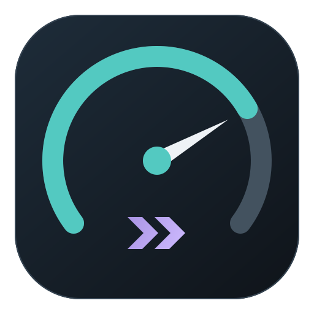

#  Speed Test Enhanced

Speed Test Enhanced is a self-hosted speed test designed and optimized for networks of 100 Gbps and beyond, with a focus on performance and measurement accuracy. It provides a browser UI and a native Go CLI, with HTTP, TCP, and UDP measurement support in a single executable and no third-party runtime dependencies.

## Features

- Download, upload, HTTP ping and jitter, live progress, and JSON results.
- UDP packet loss, duplicates, reordering, and packet jitter.
- Independent Auto calibration for download/upload, or Manual parallelism from 1 to 128.
- Saved browser settings, System/Light/Dark themes, cancellation, and Copy Results.
- IPv4/IPv6 support and a non-root Docker image.

Speeds are calculated from receiver-confirmed payload and actual elapsed time, excluding warm-up and calibration.

Auto calibrates each direction separately, doubling parallelism up to the configured limit. It compares the median of three independent 0.4-second probes at each count and keeps the smaller count unless throughput improves by more than 8%. Calibration takes up to 9.6 seconds per direction at a limit of 128, plus connection setup and acknowledged drain time. The selected count stays fixed during warm-up and measurement. Manual skips calibration.

Browser uploads compare fetch and XHR using three alternating pairs of 0.3-second probes and their median rates before selecting a transport. These probes are excluded from the measured result.

## Installation

Download the archive matching your OS and CPU from [GitHub Releases](https://github.com/tomgly/speed-test-enhanced/releases). Windows uses ZIP, while macOS and Linux use tar.gz. Extract it and run `speedtest.exe` or `./speedtest`. Go is not required for prebuilt binaries. `SHA256SUMS.txt` contains the archive checksums.

To build from source, Go 1.24 or newer is required. Supports Windows, Linux, and macOS.

Native execution is recommended, especially for high-speed measurements. Container networking and virtualization can affect performance. Docker remains supported as an option.

```powershell
go build -trimpath -o speedtest.exe ./cmd/speedtest
```

On Linux/macOS, build with `go build -trimpath -o speedtest ./cmd/speedtest` and use `./speedtest` in the commands below.

Run `speedtest --version` to check the installed version.

## Web

```powershell
.\speedtest.exe server
```

Open [http://localhost:3000](http://localhost:3000), choose Auto or Manual, and select **GO**. Settings are saved locally. Press Escape to cancel, **Test Again** to retry, or **Copy Results** to copy the result.

## CLI

Run the server on the machine to test against, then run a client:

```powershell
.\speedtest.exe client --server 192.168.1.100
.\speedtest.exe client --server 192.168.1.100 --protocol tcp --mode manual --connections 16
.\speedtest.exe client --server 192.168.1.100 --protocol udp --rate 1000000000 --mode manual --connections 4
.\speedtest.exe client --server http://192.168.1.100:3000 --protocol http --duration 5 --json
```

`--connections` sets the fixed count in Manual mode or the upper limit in Auto mode. UDP `--rate` is the aggregate target rate in bits per second.

Progress goes to stderr. With `--json`, the final result is written to stdout. Ctrl+C cancels. Failed or cancelled tests exit nonzero. Use `speedtest COMMAND --help` for all options.

## Server configuration

Default ports are **3000/TCP** for HTTP/control, **3001/TCP** for native data/control, and **3002/UDP**. UDP also requires the TCP control port.

```powershell
.\speedtest.exe server --http :3000 --tcp :3001 --udp :3002
```

Flags override environment variables:

| Variable | Default | Purpose |
| --- | --- | --- |
| `HTTP_ADDR` | `:3000` | HTTP/control address (`PORT` is a fallback) |
| `TCP_ADDR` | `:3001` | Native TCP data/control address |
| `UDP_ADDR` | `:3002` | UDP address |
| `IPV6_ORIGIN` | Empty | Optional IPv6-only HTTP measurement origin |
| `IPV4_ORIGIN` | Page origin | Optional IPv4-only HTTP fallback |
| `CORS_ORIGIN` | Empty | Exact permitted UI origin on measurement servers |

HTTPS pages require HTTPS measurement origins. For HTTP measurement endpoints, configure reverse proxies without compression, buffering, caching, or request-size restrictions. Native TCP/UDP connections are direct and unencrypted. Bind them to the intended measurement interface.

## Linux (systemd)

For persistent Linux deployments, a systemd service file is provided in [`systemd/speedtest.service`](systemd/speedtest.service).

Install the binary and create a dedicated service user:

```bash
sudo useradd --system --no-create-home --shell /usr/sbin/nologin speedtest
sudo install -m 755 speedtest /usr/local/bin/speedtest
sudo cp systemd/speedtest.service /etc/systemd/system/
```

Optionally configure ports in `/etc/default/speedtest`:

```ini
HTTP_ADDR=:3000
TCP_ADDR=:3001
UDP_ADDR=:3002
```

Enable and start the service:

```bash
sudo systemctl daemon-reload
sudo systemctl enable --now speedtest
```

Check status and logs:

```bash
sudo systemctl status speedtest
sudo journalctl -u speedtest -f
```

## Docker

Requires Docker Engine with Compose on Linux.

```sh
docker compose up --build -d
docker compose logs
docker compose down
```

Open [http://localhost:3000](http://localhost:3000). Compose publishes all three default ports and runs with a read-only filesystem and healthcheck.

For host networking on Linux:

```sh
docker build -t speed-test-enhanced .
docker run --rm --network host speed-test-enhanced server
```

Port publishing and virtualization can affect throughput. Keep native host/container ports identical because port discovery does not translate arbitrary NAT mappings. UDP requires the TCP control and UDP paths to observe the same client IP.

## Benchmark

Run repeatable benchmarks and retain the raw JSON:

```powershell
.\speedtest.exe benchmark --connections 1,4,16,32 --protocols tcp,udp,http --duration 3 --warmup 1 --repeats 3 > results.json
.\speedtest.exe benchmark --server http://192.168.1.100:3000 --connections 1,16,32 --duration 3 --repeats 3 > remote.json
```

Without `--server`, benchmarks use a loopback server in the same process. Compare browser/native, loopback/remote, and Docker/native results separately.

## Windows 11 native benchmark

Measured on Windows 11 (build 26300), Core i5-12600K (16 logical CPUs), Go 1.27.0. Server and CLI ran as separate native processes on IPv6 loopback (`::1`), in Manual mode: 10 seconds per direction, a separate 1-second warm-up, and three sequential runs per configuration. Values below are medians.

| Protocol | Connections | Download (Gbps) | Upload (Gbps) | Packet loss D/U (%) |
| --- | ---: | ---: | ---: | ---: |
| HTTP | 1 | 28.368 | 23.895 | — |
| HTTP | 4 | 102.613 | 92.334 | — |
| HTTP | 16 | 117.965 | 77.055 | — |
| TCP | 1 | 28.093 | 25.889 | — |
| TCP | 4 | 109.024 | 104.799 | — |
| TCP | 16 | 150.520 | 150.446 | — |
| UDP | 1 | 1.703 | 1.856 | 0.0000 / 0.0000 |
| UDP | 4 | 0.923 | 5.233 | 0.0000 / 0.0000 |
| UDP | 16 | 1.234 | 4.834 | 0.0000 / 0.0000 |

UDP used 1,400-byte datagrams (including the 32-byte measurement header). Its aggregate payload targets were tuned separately for download/upload: 2/2 Gbps at 1 connection, 4/50 Gbps at 4 connections, and 5/5 Gbps at 16 connections. UDP rows show the highest tested median received payload rates with loss at most 0.1% in every trial. All selected trials had zero loss. Rates include completion/drain time. Packet loss lists median download/upload percentages of lost/sent packets. HTTP and TCP had no configured rate limit.

These loopback results vary with hardware and system load. Physical links require separate validation.

## License

Copyright © 2026 tomgly. Released under the [MIT License](LICENSE).

UI icons by [Lucide](https://lucide.dev). See the [icon licenses](assets/icons/LICENSE) for ISC and MIT terms.
